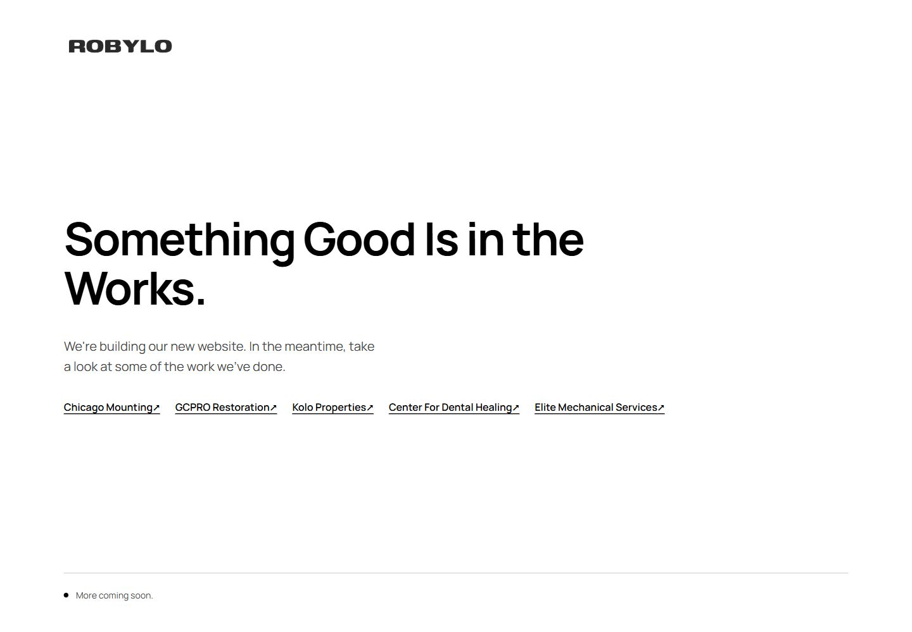
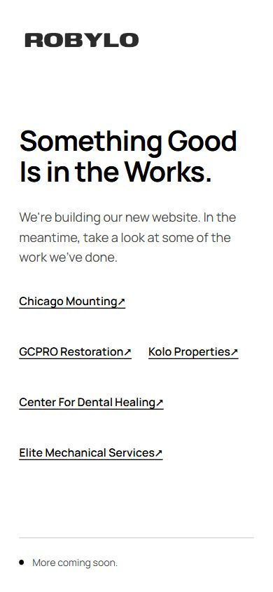

# Coming Soon portfolio update — 2026-11-16

**Implemented and verified** by ChatGPT/Codex through the connected Elementor abilities. Owner authorized publication of page 5858 only; later corrected GCPRO's destination to gcprochicago.com and the dental project label to Center For Dental Healing. Live review: https://robylo.com/.

## Published content

- H1: Something Good Is in the Works.
- Description: We're building our new website. In the meantime, take a look at some of the work we've done.
- Closing: More coming soon.

| Project | Exact destination | HTTP check |
| --- | --- | --- |
| Chicago Mounting | https://chicagomounting.com/ | 200 |
| GCPRO Restoration | https://gcprochicago.com/ | 200 |
| Kolo Properties | https://kolo-properties.com/ | 200 |
| Center For Dental Healing | https://glenviewsmiles.com/ | 200 |
| Elite Mechanical Services | https://elitemechanical.services/ | 200 |

All links use native anchor destinations and target=_blank. The dental site's own title/content confirms Center For Dental Healing at glenviewsmiles.com. The earlier gcprorestoration.com DNS failure is superseded by the owner's corrected destination.

## Exact Elementor changes

Only document **5858** was edited and published. Its legacy container 1b4eac6 / HTML widget 254e86a held embedded page CSS and text. The HTML widget is unsupported by the connected settings API, and it did not load the native shared button styles. Replaced that content with equivalent native Atomic elements so existing defaults/classes style the page, rather than copying button CSS or adding a second CSS location.

| Native element | ID | Purpose |
| --- | --- | --- |
| Main | 564029df | White full-height page shell |
| Brand / image | 187eeef8 / 59fcc9c3 | Original owner-provided PNG |
| Message section | 5d5cf73d | Existing left alignment and vertical balance |
| H1 / paragraph | 7dcba054 / 72a5c26a | Approved copy |
| Project navigation | 439033ae | Wrapping flex row |
| Chicago / GCPRO links | 5e63bbad / 60f6ce67 | Native e-button anchors |
| Kolo / Dental / Elite links | 502777fa / 1641e88c / 346d6241 | Native e-button anchors |
| Footer / rule | 78314421 / 2fe03732 | Existing simple separator |
| Closing row / dot / copy | 36d57f5d / 3272624b / ba72dbe | Existing footer treatment |

Reused rb-btn (g-aec96cc), rb-btn--text (g-e61c4f8), rb-hero__subtitle and rb-hero__eyebrow; existing semantic H1 and font defaults. No new global variables/classes, component definitions, custom CSS, JavaScript or dependencies. Primary Button 5864 is unchanged; these are lightweight native text-link instances. Static external-arrow spans were added; no new animation. Elementor strips aria-hidden from text HTML, so arrows remain in accessible link names; links still have descriptive project names.

Original logo uploaded as attachment **5972**, https://robylo.com/wp-content/uploads/2026/11/logo_robylo.png. PNG remains 300×80, displayed at 180×48 with alt ROBYLO. Downloaded asset bytes match the provided original exactly (SHA-256 5c1507ac021b29b4b9e9f6ddfa91340d1235cbd595aaef56eacf531f0b5ddd30).

### Native local layout settings

Main: min-height 100vh; width 100%; flex column; padding 48px clamp(24px,7vw,112px), mobile vertical padding 32px. Uses rb-paper / rb-ink. Message: flex column, grow 1, centered vertically, max-width 1000px, padding 100px 0 96px (mobile 80px 0), gap rb-space-3. Description max-width 500px. Navigation: flex row, wrap, align center, gap rb-space-3. Links retain native shared minimum height 48px, 4px radius and underlines. Footer: 1px rb-line separator, 24px gap, 7px dot, 14px closing text. No page layout/template or visibility setting was changed.

## Verification and evidence

Actual anonymous public browser checks, 2026-11-16:

- 1440px desktop; 1024px and 768px tablet; 390px and 320px mobile: heading/body wrapping and links remain within the viewport. No horizontal overflow.
- Rendered H1: Manrope 700, 72/77.76px desktop; 56/61.6px tablet; 40/44.8px mobile. Description 20/32px desktop/tablet, 18/28.8px mobile. Links Manrope 600, 16/20px, 48px high.
- Manrope font load check passed. Logo loaded at original natural dimensions.
- Actual keyboard Tab moved between project links. Visible focus: black 2px solid outline, 2px offset. Real pointer hover: #333 text with underline. No new animation was added.
- Public root returned HTTP 200 and displayed Coming Soon content without authentication. Coming Soon gate/assignment was not modified.
- Protected page trees 5894 (homepage), 5892 (Header), 5893 (Footer), 5776 (Atomic Lab) match their pre-task structures exactly. No edits were sent to those documents.
- All five external destinations returned HTTP 200 at the exact URLs above. Native rendered anchor href and target attributes verified; full external-site workflows were not tested.
- Native settings were read back after publication. Full-page screenshots show public content only, without admin UI or private preview tokens.

## Limits and portability

Browser viewport emulation, not physical-device testing or a complete accessibility audit. Mobile uses natural link wrapping, rather than a rigid grid. Existing global button classes are live WordPress database state; this PR documents their reuse and does not merge unrelated button/homepage PRs. The page, local native styles, Media Library reference and Coming Soon assignment remain database-only; no native export/import round-trip is claimed. GitHub changes are documentation/evidence, not deployment code.

Rollback: revision 5945 is the pre-conversion document snapshot if retained by WordPress. Restoring it would remove all subsequent Coming Soon content changes; publish the restored document separately. Uploaded logo need not be deleted.
