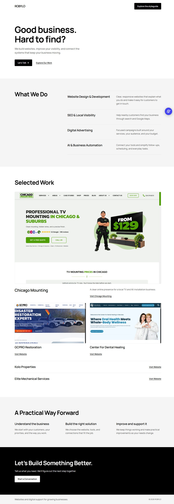
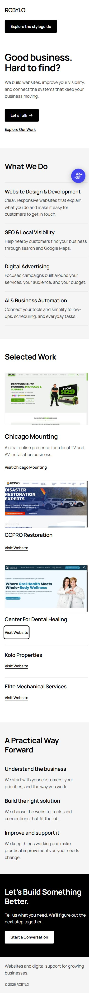

# Homepage V1 prototype — 2026-11-16

**Implemented as unpublished changes on Home 5894; verified in authenticated Chrome; awaiting owner visual review.** Collaborator: ChatGPT/Codex via Elementor's supported abilities and native editor. This is a prototype, not launch approval.

## Scope and source

Read current main, README, AGENTS, AI-CONTEXT, decisions, implementation records, Claude's handoff/design log and desktop mockup, plus open PRs #3–#6. Main at start/end inspection: 0a3d8f88f7710531088b84f8e9407e309d9a00c4. No PR merged.

The owner's Homepage V1 brief authorizes a complete composition on existing page 5894. Subsequent owner replies confirm **info@robylo.com** and **leave Header unchanged**. The original PNG is untouched; the existing Header's provisional text brand remains intentionally. Header/Footer redesign and original-logo placement are outside this iteration.

## Actual composition

| Section | Background | Native root ID | Content |
| --- | --- | --- | --- |
| Hero | Light | cf2ad51 | One H1, supporting paragraph, Let's Talk / Explore Our Work |
| Services | Soft | 40ee9ba | Four service rows with useful descriptions |
| Selected Work | Light | 8080c9f | Featured Chicago Mounting, two image previews, two restrained link rows |
| Approach | Soft | 14b9b3e2 | Understand → Build → Improve and support |
| Contact | Dark | 2dc01674 | Base Section 5869 instance 4353b888, inverse CTA |
| Header / Footer | Existing | Documents 5892 / 5893 | Unchanged active templates |

Preserved Base page 1abcec4 and Main content 1117679b. Replaced the prior four draft placeholder wrappers only; build returned removed IDs 3e24b183 / 52f70841 / 5635dbc7 / 2983f565. Pre-change undo revision **5989** records that draft state. Published two-section foundation remains unchanged. No publish action was called for Home 5894.

### Reuse and native settings

- **Base Section 5869** reused for Contact, nesting Heading and Text 5877 and Primary Button 5864. These library definitions were not edited.
- **Primary Button 5864** reused for Hero primary/secondary, five portfolio actions and the nested Contact action. Hero instance 6d727e68; secondary 6a2404b6.
- Reused rb-section, rb-section--soft, rb-section--dark, l-container, rb-hero__subtitle, rb-btn--text and **rb-btn--glide**. Standard button root retains rb-btn / rb-btn--primary.
- Exactly one Homepage wrapper opts into Glide-Over: **2535b2d5**, containing Hero primary. Label override is Let's Talk. No global rollout or change to animation rules.
- No new global class, variable, component, custom CSS, JavaScript, dependency, theme file or WordPress Additional CSS. Global class inventory/order and variable resource match the pre-task read.
- Native local layout settings: section padding/gutters/container come from existing classes; 1200px container and 24px stack gap. Services use a 1:2 horizontal split with 48px gap, stacking at tablet. Service rows have 32px padding, 1px rb-line separators and a two-column title/copy layout; at mobile they stack with 8px gap and 24px vertical padding.
- Work uses a full-width featured image and caption, two equal preview columns with 32px gap, then two full-width project link rows. Preview/caption layouts stack at mobile. Images retain natural proportions (width 100%, height auto), 1px rb-line border and existing 4px radius; no distortion or invented artwork.
- Approach uses three columns with 48px gap, stacking at tablet. No diagram or decorative icon.
- New link targets were set through **native editor General → Settings → ID**, because that common field is not exposed in the connector's widget schemas: **work** on H2 97128dd and **contact** on wrapper 2dc01674. Saved with **Save Draft**. No custom anchor widget/CSS/JS was required.
- Native image links were removed during keyboard review; the existing styled text actions provide the project destinations without duplicate, unstyled image focus stops.

The initial inline span IDs were stripped by content sanitization; only the native ID controls above provide the final working anchors. Do not attempt to recreate those IDs in heading HTML.

## Content and real project evidence

Hero: “Good business.” / “Hard to find?” with a real line break. Copy: “We build websites, improve your visibility, and connect the systems that keep your business moving.”

Services: Website Design & Development; SEO & Local Visibility; Digital Advertising; AI & Business Automation. Short descriptions explain the service without outcome guarantees.

Three new Media Library assets are actual anonymous public website captures taken during this task:

| Project | Attachment | Destination |
| --- | --- | --- |
| Chicago Mounting | 5986 | https://chicagomounting.com/ |
| GCPRO Restoration | 5987 | https://gcprochicago.com/ |
| Center For Dental Healing | 5988 | https://glenviewsmiles.com/ |

Kolo Properties → https://kolo-properties.com/ and Elite Mechanical Services → https://elitemechanical.services/ appear as concise linked rows, not two more repetitive image cards. All five destinations are the owner's exact URLs.

No invented results, testimonials, service attribution, statistics or case-study claims. Numbers visible inside the real project screenshots are the source websites' own content, not claims about ROBYLO's results.

Hero anchors: Let's Talk → #contact; Explore Our Work → #work. Contact button → **mailto:info@robylo.com**, supplied by owner. No message was sent.

## Actual verification

Chrome browser viewport emulation on the authenticated WordPress draft preview, 2026-11-16. Full-page screenshots were visually inspected. Original Header/Footer remain visible.

| Viewport | H1 / H2 | Section vertical padding | Result |
| --- | --- | --- | --- |
| 1440 | 72 / 48px | 100.8px | No horizontal overflow |
| 1024 | 56 / 40px | 71.68px | No horizontal overflow |
| 768 | 56 / 40px | 56px | No horizontal overflow |
| 390 | 40 / 32px | 56px | No horizontal overflow |
| 320 | 40 / 32px | 56px | No horizontal overflow; H1 naturally takes three lines |

- Manrope 700 H1/H2 headings, 20/32px Hero paragraph desktop/tablet and 18/28.8px mobile; existing body/default scale retained. Full headline is present at every width. Minimum measured action height **48px**.
- Section sequence/backgrounds: #FFFFFF → #F5F5F5 → #FFFFFF → #F5F5F5 → #000000; contact heading/body white and button white/black. Black/white contrast 21:1; existing dark-gray text on white/soft remains readable.
- Actual clicks on both Hero links reached their native fragment targets. Work heading landed below the admin toolbar; Contact scroll is capped by the bottom of the page as expected.
- Real pointer hover on Hero: label moves 24px; trailing arrow moves 32px out; leading arrow appears. Target remains approximately 143.03 × 53.33px. Only one opted-in Homepage instance.
- Reduced motion: label transform none, transition 0s; leading arrow hidden, trailing arrow visible. Touch emulation: coarse pointer, no hover, transition 0s.
- Keyboard navigation: Hero primary, secondary and inverse Contact action retained :focus-visible and 2px outline plus existing contrasting focus ring. Portfolio destinations use the same existing text-button treatment.
- Images loaded after native lazy-loading/scroll, retain natural proportions and alt text; final screenshots include all three actual images.
- All five external websites returned **HTTP 200** at their exact destinations. External website forms/workflows and actual email delivery were not tested.
- Public anonymous https://robylo.com/ returned HTTP 200 with “Something Good Is in the Works.”; new Hero absent. **Coming Soon remains active.**
- Protected trees **5858, 5892, 5893, 5776, 5774** match pre-task snapshots. Existing shared component definitions were not edited; no global styling mutation was sent.
- Underlying Home post remains published with its old modification date/content; V1 is a saved autosave/draft preview only. Connector structure reads show the published foundation, so the native editor draft preview is the visual verification source.

## Screenshots and review

Use [Home 5894 in Elementor](https://robylo.com/wp-admin/post.php?post=5894&action=elementor), then **Preview Changes** while logged in. Do not publish for review. Signed preview tokens and admin/account information are not committed.

Screenshots crop the administration toolbar, preserving the full Header-to-Footer composition. Actual content capture widths are 1425px / 375px because Chrome reserves a 15px scrollbar. The purple floating assistant bubble is an editor overlay, not part of the design. Full-page screenshots are actual browser captures, not HTML recreations.

## Limits, dependencies and rollback

- Owner visual approval remains pending. No public homepage launch, Header/Footer redesign, other pages or SEO work.
- Header retains its provisional text logo and styleguide CTA, including the existing stacked mobile behavior, per the owner's explicit reply. This differs from Claude's proposed marketing navigation/logo.
- At 320px the unchanged 40px H1 wraps to three lines to remain readable; no overflow hiding or unapproved type-size reduction.
- Three projects have screenshots; two deliberately use link rows. Captures are review assets, not optimized production exports, and include source-browser scrollbars.
- Optional Hero recording was attempted but the screenshot capture command timed out. No successful video/GIF is claimed; actual hover and media-preference checks above passed.
- Browser simulation only; no physical-device, cross-browser, performance or complete accessibility audit. Mailto depends on the visitor's email handler.
- Live button/Glide classes already exist in WordPress, documented by unmerged **PR #4** and **PR #5** (the latter targets #4). **PR #3** records the superseded draft skeleton; **PR #6** records the public Coming Soon update. This task consumes the live foundation without merging any of those PRs. Reconcile documentation when the owner chooses merge order.
- New page composition, native IDs/local styles, component overrides and media references remain WordPress database state. This PR is a documentation/evidence handoff, not a portable Elementor export or automated deployment.
- To roll back, inspect newer draft edits first. Revision **5989** predates V1 and can restore the prior four-section draft if still retained; a full restore would discard subsequent owner edits. Do not restore or publish protected documents.

## Owner-requested save — 2026-11-16

After reviewing the old foundation at the normal site URL, the owner explicitly requested saving V1 immediately as the current page. Promoted the existing reviewed draft on 5894 using Elementor publish-document; no rebuild, global edit or template change. Authenticated https://robylo.com/ now renders “Good business. Hard to find?” without a draft preview link. Anonymous root still returns HTTP 200 with Coming Soon and no V1 headline. This supersedes the unpublished-only status above for storage of the Home document; the public Coming Soon gate remains active and public launch is not enabled. PR #7 remains open; no PR merged.
